# Kitbag 🎒

**The open-source everything-app for musicians.** Metronome, tuner, song
library, stem player, play-along sync — one app, plugin-shaped, GPLv3,
no caps, no paywalls, ever.

> **Status: rebuilding, nothing released.** An audit on 2026-07-17 found the
> previous Flutter build was a broad UI shell over an audio core missing two
> primitives the product depends on — it could neither play a file nor start the
> click at a known instant. That app has been removed; the C++ core stays and now
> has both.
>
> **[SPEC.md](SPEC.md) is the source of truth** — scope, contracts, decisions and
> sequencing. It is the only planning document; `PLAN.md` was folded into it and
> deleted. `CHANGELOG.md` previously claimed five shipped releases and has been
> corrected — nothing has shipped.

## What it looks like

Screenshots from Android builds, dark theme then light; the stem screens come from
an emulator with test data.
The metronome is being redesigned (#175) and is not shown.

<table>
  <tr>
    <th>Home</th>
    <th>Metronome</th>
    <th>Songs</th>
    <th>Stem songs</th>
    <th>Stem player</th>
    <th>Tuner</th>
  </tr>
  <tr>
    <td>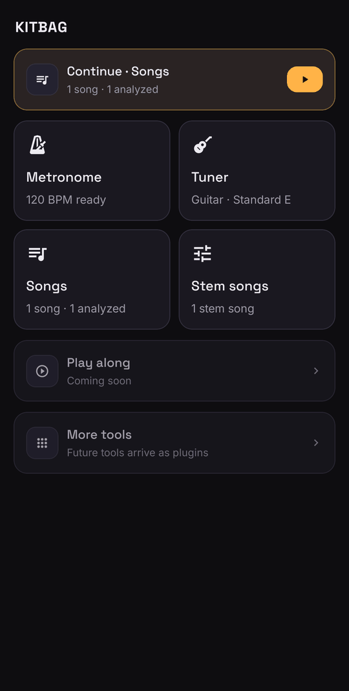</td>
    <td>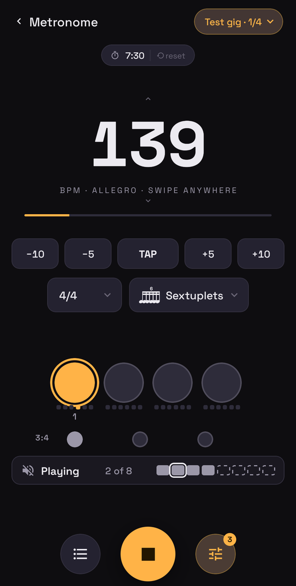</td>
    <td>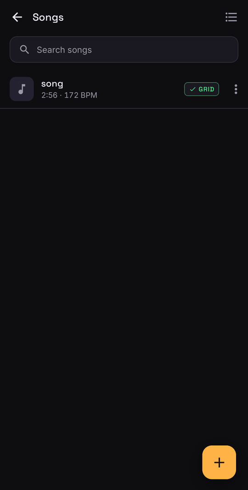</td>
    <td>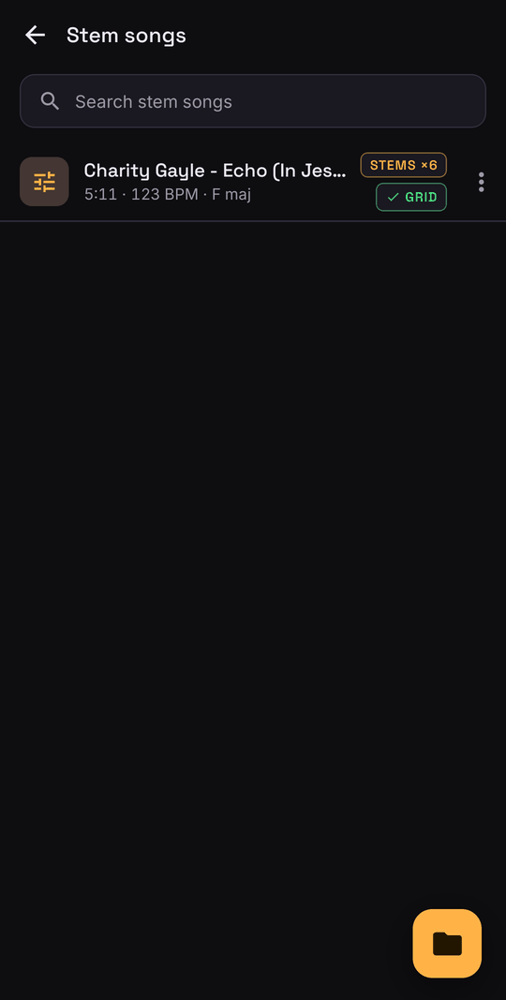</td>
    <td>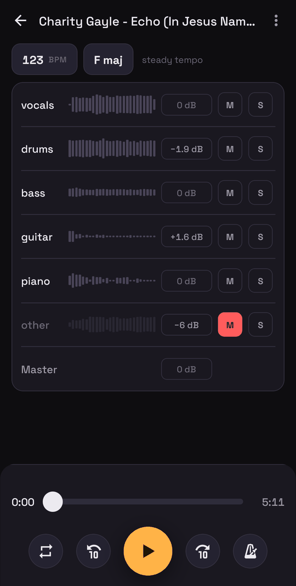</td>
    <td>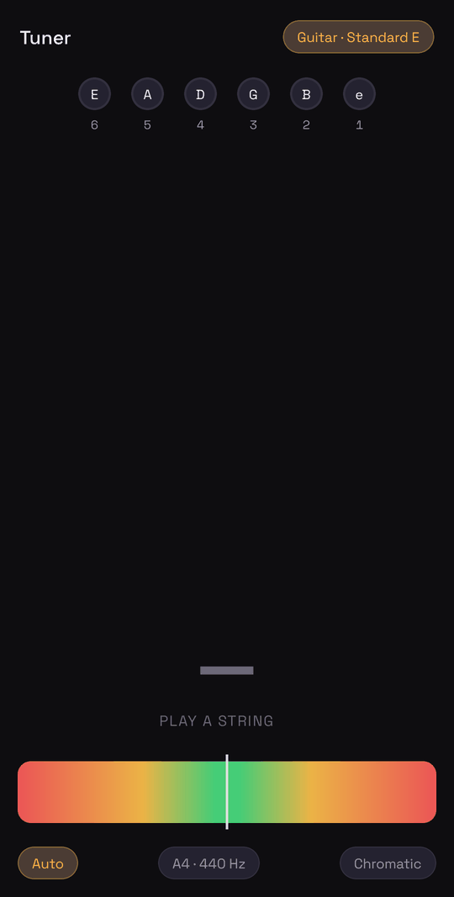</td>
  </tr>
  <tr>
    <td>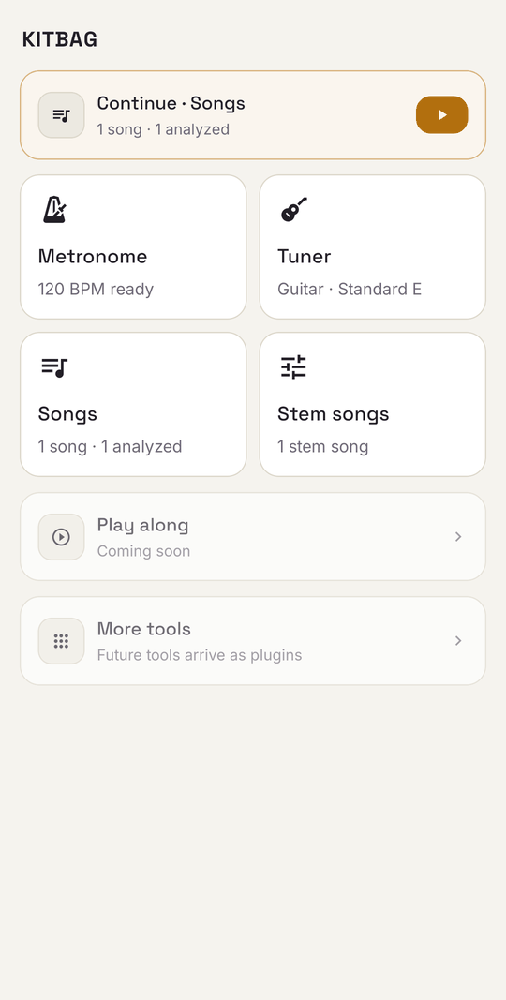</td>
    <td>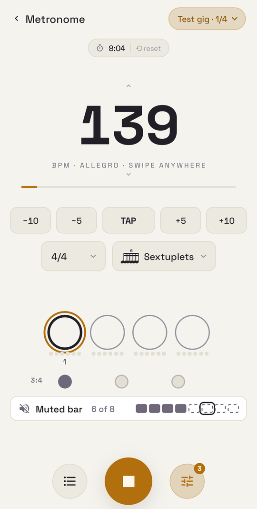</td>
    <td>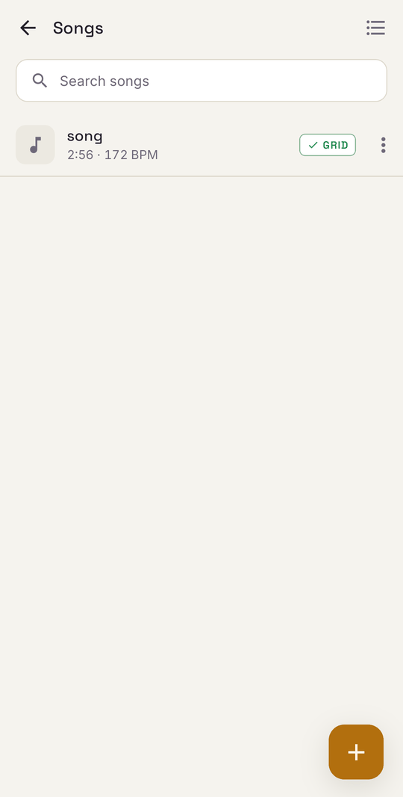</td>
    <td>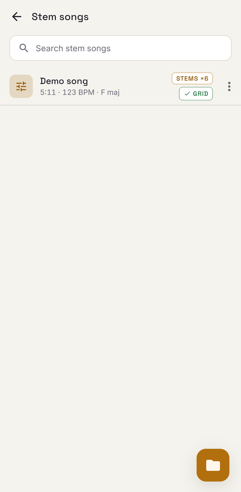</td>
    <td>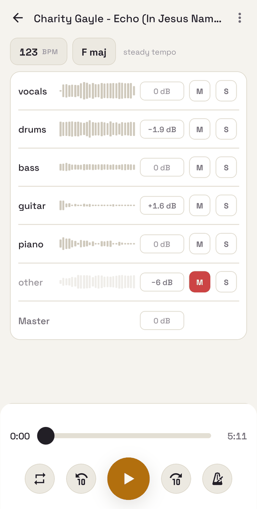</td>
    <td>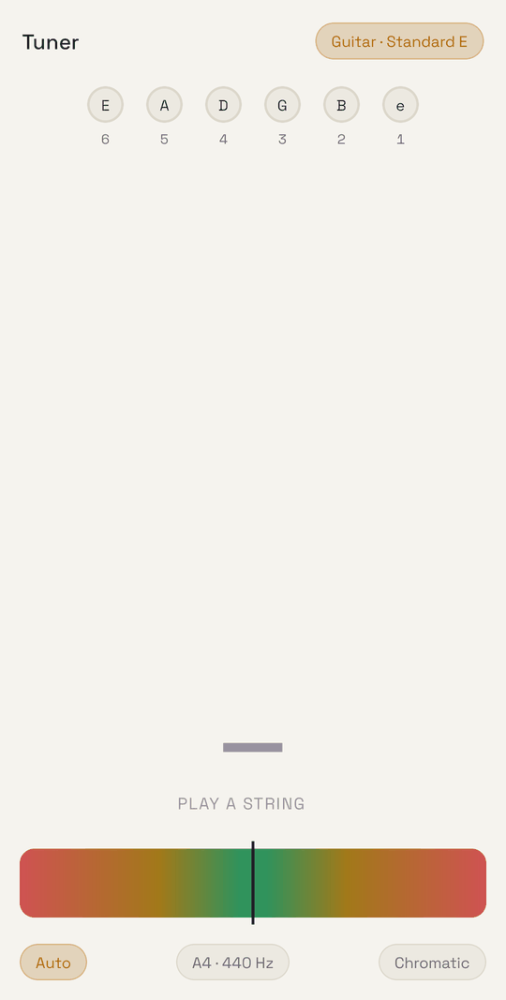</td>
  </tr>
</table>

## Install (Android)

The newest signed build is always at
<https://github.com/PinetheApple/kitbag/releases/latest/download/kitbag.apk>,
with its checksum alongside. It is built for arm64-v8a only (64-bit ARM phones).

```sh
curl -fLO https://github.com/PinetheApple/kitbag/releases/latest/download/kitbag.apk
curl -fLO https://github.com/PinetheApple/kitbag/releases/latest/download/kitbag.apk.sha256
sha256sum -c kitbag.apk.sha256
```

Then open `kitbag.apk` on the phone (allow installs from that source), or
`adb install kitbag.apk`. Later releases install over it.

If you have a debug-signed development build installed, uninstall it first: a
build signed with a different key cannot update it.

## Architecture

- **C++ realtime audio core** (`native/audio_core`) on miniaudio — sample-accurate
  scheduling, lock-free realtime thread. **The durable part.** A flat C ABI
  (`include/kitbag_api.h`) written so the UI framework is a swappable detail,
  which it turned out to be.
- **React Native + TypeScript** UI, reached via JSI — decided 2026-07-17
  ([SPEC.md](SPEC.md) §13). Commands go through a TurboModule; polled realtime
  reads go through a JSI HostObject. Builds and runs on Android; the 60fps read
  path is proven on a device (§13.3). Rebuilt so far: the metronome, the tuner,
  the song library and the stem player. Play along and Settings are not built.
- **Internal plugin system** — every tool declares itself to a shell that is just
  a registry. First-party only; no public SDK yet.

Android is the primary target. iOS is secondary (play-along is Spotify-only there
— a platform limit, not a bug). Web is **out of scope**: no cross-app media
session, no foreground service.

```
native/audio_core   # C++ engine (miniaudio), CMake
packages/           # React Native app — pnpm workspaces + Turborepo
SPEC.md             # source of truth
design/             # binding design specs (precedence: SPEC.md §12)
legacy/             # Flutter-era media-session code play-along still has to port
docs/               # decisions, tuner spec, research; archive/ is historical
scripts/            # repeatable actions — lint, format, worktrees, changelog
```

## Building

### Native core

Requirements: CMake ≥ 3.22, Ninja, clang.

```sh
cmake -S native/audio_core -B native/audio_core/build -G Ninja -DKITBAG_BUILD_TOOLS=ON
cmake --build native/audio_core/build

./native/audio_core/build/player_verify      # single-source transport, offline — passes
./native/audio_core/build/metronome_verify   # renders offline, asserts onsets — passes
./native/audio_core/build/tuner_verify       # tuner on synthetic tones — passes
```

The verify tools render audio offline and assert against it — no UI, no device.
This is why the core was testable before the app existed, and it is still the
cheapest signal in the project.

### App

Requirements: Node (version in `.nvmrc`), pnpm, Android SDK + NDK.

```sh
pnpm install
pnpm -w typecheck && pnpm -w lint && pnpm -w test
```

Android builds run from `packages/app-shell/android` via Gradle;
`bash scripts/install-on-device.sh` builds, installs and launches on a connected
device. Anything that touches a screen or the native boundary needs verifying on a real device — the
headless gates cannot see a broken JNI chain.

## License

GPLv3 — see [LICENSE](LICENSE). Native dependencies: miniaudio (public domain),
QM-DSP (GPL-2.0-or-later, with kissfft under BSD-3-Clause). Fonts: Space Grotesk
and Inter (OFL).
